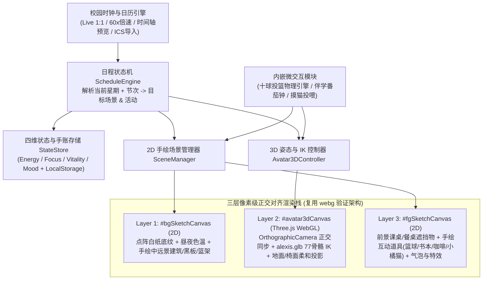

# 产品需求文档（PRD）：《林小夏的数字人生》(Lin Xiaoxia's Digital Life)

> [!IMPORTANT]
> **核心产品一句话定义**：一款运行在浏览器端、**与现实大学作息实时同步**的「**3D 写实女大学生 × 2D 极简手绘纸面世界**」数字人生陪伴与轻交互模拟 Web 应用。角色本体采用 Hugging Face 开源 3D 骨骼模型（`alexis.glb`），所处的教室、球场、图书馆、宿舍、食堂、K歌房等场景与交互物件全部延续 [webg](file:///c:/Users/ASUS/AntiG/webg) 的**点阵白纸 + 手绘微晃墨线（Goofy Fish 风格）**，形成极具辨识度的破次元陪伴体验。

---

## 1. 产品背景与体验目标

### 1.1 设计初衷
- **痛点**：传统虚拟陪伴/电子宠物要么是纯静态立绘缺乏真实时间流动感，要么是全 3D 大场景制作沉重且审美疲劳。
- **破局点**：延续我们在十球投篮项目中验证成功的 **「3D 骨骼写实人物 + 2D 极简手绘点阵纸面」** 视觉语言——既有真实女大学生的鲜活肢体细节（弯腰、记笔记、投篮压腕、戴耳机翻书、持麦唱歌），又保留手账绘本般干净治愈的留白呼吸感，打开网页即可作为**桌面数字伴学/伴工挂件**全天候运行。

### 1.2 核心体验支柱
1. **真实时间同频（Live Campus Clock）**：默认与用户本机系统时钟 `1:1` 同步。上午 8:30 打开网页，她在阶梯教室上《计算机图形学》；下午 4:30 打开，她在球场练投篮；晚上 8:00 打开，她在图书馆靠窗刷题；深夜 11:30 打开，宿舍熄灯只留小夜灯呼吸入睡。
2. **破次元视觉张力（3D Human × 2D Sketch Paper）**：人物是带 77 根骨骼与光影投射的 3D 亚洲校园女生（复用 `alexis.glb` 并支持扩展换装 `.glb`），而课桌、黑板、篮球、书架、餐盘、小橘猫全是带手绘抖动算法（`WOBBLE`）的 2D 黑白墨线 + 暖琥珀点缀色（`#f59e0b`）。
3. **零打扰陪伴 + 可玩小游戏内嵌**：平时是安静鲜活的桌面陪伴（Autonomous Mode）；当玩家想互动时，可一键切入**实操小玩法**（例如体育课直接无缝接管十球投篮、自习时开启 25 分钟番茄钟伴学、娱乐时切歌打节拍、导入玩家自己的真实大学 `.ics` 课表）。

---

## 2. 角色设定与四维生命状态

### 2.1 主角档案
| 维度 | 设定详情 |
| :--- | :--- |
| **姓名 / 年龄** | 林小夏（20 岁，大二下学期 · 第 8 教学周） |
| **院系专业** | 数字媒体技术（理工与艺术交叉专业，课表兼具高数/图形学与设计创作课） |
| **校园身份** | 梅园 402 寝室室友、院女篮控卫、周末音乐社常客 |
| **3D 基础模型** | Hugging Face `tanish434/Mixamo-Animations-Characters` → `Alexis.glb`（1.37 MB，77 骨骼，短发刘海 + 白色有线耳机 + 运动背心 + 护腕 + 球鞋），兼容后续无缝替换其他 Mixamo / Tripo3D `.glb` |
| **性格基调** | 元气稳健、有点冷幽默、上课认真记笔记但遇到高数也会叹气、打球进空心会开心握拳 |

### 2.2 四维状态数值体系（State Meters）
状态值范围均为 `0–100`，随时间表日程自然增减，并影响小夏的**微动作姿态、头顶气泡碎碎念与运动表现**：

| 状态指标 | 图标与色值 | 自然消耗场景 | 恢复场景 / 玩家互动加成 | 低于阈值（`< 30`）表现 |
| :--- | :--- | :--- | :--- | :--- |
| **精力 (Energy)** | `⚡ #f59e0b` | 早八连堂课、高强度运动、熬夜 | 午休小憩、夜间睡眠、「投喂冰美式/奶茶」 | 课堂托腮打盹、走路节奏放缓 |
| **专注 (Focus)** | `📖 #2563eb` | 长时间刷手机/娱乐 | 专业课听讲、图书馆自习、「开启伴学番茄钟」 | 翻书频率变慢、碎碎念走神 |
| **活力 (Vitality)** | `🏀 #16a34a` | 久坐上课/机房写代码 | 篮球场投篮、操场慢跑、羽毛球、「约去打球」 | 伸懒腰揉肩膀提示久坐 |
| **心情 (Mood)** | `✨ #ec4899` | 满课周三、阴雨天、投篮连铁 | 食堂美食、K歌房唱歌、湖畔撸猫、投中空心球 | 轻叹气表情气泡，渴望投喂或听歌 |

---

## 3. 真实大学生日历与课程时间表系统

### 3.1 时间运行三模式
1. **实时同步模式（默认 `LIVE`）**：读取浏览器本地时间 `new Date()`（精确到星期几 + 时分秒），自动匹配当前时刻对应的课程或生活日程，并同步昼夜纸面光线（晨光暖白 → 正午纯白 → 傍晚暖杏 → 深夜静谧蓝灰点阵）。
2. **倍速观察模式（`60× / 300×`）**：1 分钟走完 1 小时或 5 小时，方便快速欣赏小夏一整天的转场与生活轨迹。
3. **自由时间轴 / 课表点选预览（`Preview Override`）**：拖动底部 24h 时间轴滑块，或点击「周课表抽屉」中任意一节课/活动块，立即跳转到该时段与对应场景（右上角显示「返回实时同步」胶囊按钮）。

### 3.2 标准大二真实周课表（内置默认模板 + 支持自定义/ICS 导入）

遵循国内高校标准 **12 节作息制**（早八 `08:00` 起，每大节 95–100 分钟，含午休与晚自习）：

| 时段 | 周一 | 周二 | 周三 | 周四 | 周五 | 周六 | 周日 |
| :--- | :--- | :--- | :--- | :--- | :--- | :--- | :--- |
| **07:20–07:55** | 宿舍洗漱 & 桂园早餐 | 宿舍洗漱 & 桂园早餐 | 宿舍洗漱 & 桂园早餐 | 宿舍洗漱 & 早餐 | 睡懒觉 & 买豆浆 | 自然醒慢生活 | 自然醒慢生活 |
| **08:00–09:40**<br>*(1–2节)* | **概率论与数理统计**<br>`阶梯教室 A204` | **图书馆早自习**<br>`图书馆三楼` | **计算机图形学**<br>`阶梯教室 B301` | **大学英语视听说**<br>`语音教室 C102` | *没早八 · 宿舍补觉/整理*<br>`梅园402` | **晨间湖畔慢跑**<br>`未名湖绿道` | **街角咖啡看书**<br>`校门咖啡书屋` |
| **10:00–11:40**<br>*(3–4节)* | **交互设计原理**<br>`设计工坊 D402` | **数据结构与算法**<br>`阶梯教室 A108` | **三维造型与动画**<br>`机房实验楼 E205` | **图书馆刷题/写作业**<br>`图书馆靠窗位` | **数字影像创作**<br>`阶梯教室 B206` | **图书馆自由阅读**<br>`图书馆三楼` | **宿舍手账/画速写**<br>`梅园402` |
| **11:50–13:50** | 食堂干饭 + 宿舍午休 | 食堂干饭 + 宿舍午休 | 食堂干饭 + 宿舍午休 | 食堂干饭 + 午休 | 食堂小火锅 + 午休 | 食堂聚餐 | 外卖/水果轻食 |
| **14:00–15:40**<br>*(5–6节)* | **图形学上机实验**<br>`机房 E205` | **中国近现代史纲要**<br>`大阶梯教室 A101` | **体育专项：女子篮球**<br>`室外2号篮球场` | **UI/UX 课程设计**<br>`设计工坊 D402` | **社团活动筹备**<br>`咖啡书屋/活动室` | **好友KTV包间欢唱**<br>`校外量贩KTV` | **图书馆复盘下周计划**<br>`图书馆三楼` |
| **16:00–17:50**<br>*(7–8节)* | **十球投篮特训**<br>`室外2号篮球场` | **操场 3km 慢跑 & 撸猫**<br>`田径场/湖畔` | **院女篮半场加练**<br>`室外2号篮球场` | **十球投篮特训**<br>`室外2号篮球场` | **湖畔散步拍夕阳**<br>`未名湖绿道` | **KTV 怀旧金曲合唱**<br>`KTV包间` | **傍晚投篮热身**<br>`室外2号篮球场` |
| **18:00–19:20** | 二食堂晚餐 | 桂园食堂晚餐 | 食堂加鸡腿晚餐 | 食堂晚餐 | 周五夜市小吃 | 商业街晚餐 | 食堂晚餐 |
| **19:30–21:20**<br>*(9–10节)* | **图书馆晚自习**<br>`图书馆靠窗位` | **选修：电影音乐鉴赏**<br>`阶梯教室 C208` | **图书馆晚自习**<br>`图书馆靠窗位` | **课程小组线上讨论**<br>`梅园402书桌` | **校园音乐角弹唱/K歌**<br>`活动室K歌台` | **宿舍追番 & 游戏时光**<br>`梅园402` | **宿舍整理书包备课**<br>`梅园402` |
| **21:30–23:00** | 宿舍洗漱 · 桌前听歌/放松 | 宿舍桌前小游戏/日记 | 宿舍拉伸 · 睡前阅读 | 宿舍桌前听歌/手账 | 宿舍熬夜联机小游戏 | 宿舍深夜电台 | 早睡养精蓄锐 |
| **23:00–07:20** | 熄灯睡眠（静音呼吸） | 熄灯睡眠 | 熄灯睡眠 | 熄灯睡眠 | 23:45 熄灯睡眠 | 23:45 熄灯睡眠 | 熄灯睡眠 |

> [!TIP]
> **真实课表自定义与导入能力**：支持用户在「周课表抽屉」中直接点击格子编辑课程名称/地点/类型，并支持一键导入标准 `.ics` 日历文件（苹果日历 / Outlook / WakeUp 课程表导出的 `.ics`），把小夏的日程变成用户自己真实的大学课表！

---

## 4. 八大 2D 极简手绘场景与 3D 动作映射规范

所有场景统一采用 **白底圆点阵背景（`24px` 间距） + 黑色手绘微抖墨线（`#141414`，复用 `WOBBLE` 正弦扰动算法） + 单一暖琥珀/柔粉语义高光色**，前景与中景拆层以保证 3D 角色遮挡自然（例如坐进课桌后，课桌前缘在 `#fxCanvas` 遮住腿部）：

| 编号 | 场景 ID 与名称 | 2D 手绘背景层 (`#gameCanvas`) | 2D 前景遮挡与交互道具 (`#fxCanvas`) | 3D 角色 (`alexis.glb`) 专属姿态与 IK 动作 | 内嵌可玩交互 |
| :--- | :--- | :--- | :--- | :--- | :--- |
| **S1** | `classroom`<br>**阶梯教室 / 机房** | 黑板（动态手写高数积分/图形学矩阵草图）、投影幕布、大玻璃窗与梧桐树枝、后排阶梯桌椅轮廓 | 前排木质书桌前挡板、翻开的方格笔记本、立着的轻薄本电脑、保温杯冒热气动画 | **坐姿 IK**：屈髋屈膝坐于椅面，右手握笔在桌面小幅往复书写 → 每隔 8s 抬头看黑板点头 → 偶尔左手托腮思考 | 点击黑板切换板书彩蛋；点击「伴学番茄钟」开启 25min 专注倒计时 |
| **S2** | `basketball`<br>**室外 2 号篮球场** | 完整继承 `webg` 篮架、篮板、篮筐、手绘地面与远景铁丝网围栏线条 | 左侧滚动五球架、2D 物理篮球、蓄力条、空心彩带特效 | **全套投篮 IK**：转身弯腰抓球 → 3/4 站姿双手托球 → 蓄力屈膝 → 起跳伸臂鹅颈压腕随挥 | **无缝可玩**：默认 Auto 无限练球，玩家按 `Space` 或点画布直接接管投篮！ |
| **S3** | `library`<br>**图书馆三楼靠窗位** | 顶天立地手绘书架阵列、落地拱窗（随时间飘云/落日/星空）、静音钟表 | 宽木阅读桌、暖黄光锥小台灯（`#fef3c7` 半透明光晕）、一摞教材、冰美式杯 | **专注阅读/敲码 IK**：微低头翻页动作、双手轻放键盘打字循环、偶尔端杯喝一口咖啡 | 白噪音开关（翻书声 / 窗外微风 / 轻柔雨声）；伴学计时统计 |
| **S4** | `dorm`<br>**梅园 402 上床下桌** | 上床下桌铁艺梯架、床帘与星星挂串、衣柜贴纸、宿舍门牌、墙面便签墙 | 下桌电脑显示器微光、机械键盘、小盆栽、懒人靠背椅；23:00 后切为深蓝灰夜色遮罩 + `Zzz` 气泡 | 白天/傍晚：坐姿敲键盘、伸双臂大懒腰；23:00 后：切换上铺侧卧/安静呼吸待机（或桌前小夜灯静坐） | 点击显示器打开「小夏今日手账」；点击盆栽浇水长出新叶 |
| **S5** | `canteen`<br>**桂园大学食堂** | 打饭档口玻璃窗、「今日特供：糖醋排骨/番茄牛腩」手写木牌、吊灯线条 | 餐桌前缘、分格不锈钢餐盘、筷子勺子、袅袅热气曲线 | **就餐互动 IK**：坐姿双手扶碗/夹菜微动、吃到美食开心晃头微笑 | 点击菜牌为小夏「今天加鸡腿 / 点奶茶」，立即提升心情与精力 |
| **S6** | `track`<br>**未名湖绿道 & 操场** | 塑胶跑道透视线、湖面波纹线条、远景柳树与路灯、视差滚动的地面 | **手绘小橘猫**（蹲在长椅旁或跟跑）、飘落银杏叶粒子 | **慢跑 / 蹲身撸猫 IK**：自然摆臂慢跑循环（背景向左视差平移）；点击小猫时小夏停步屈膝俯身摸猫头！ | 点击小橘猫触发「蹲下摸猫」彩蛋与呼噜音效 |
| **S7** | `ktv_club`<br>**社团 K 歌房 / 音乐角** | 手绘复古点歌电视框（滚动歌词波浪线）、沙发轮廓、墙面音符涂鸦、顶部旋转灯球光斑 | 茶几小果盘墨线画、复古立式麦克风架、飘散音符粒子 `♪ ♫` | **持麦演唱 IK**：站立握住立麦，身体随节拍轻晃，副歌时左手自然抬起打拍子 | 点击点歌屏切换曲风节奏（抒情慢歌 / 轻快校园民谣 Web Audio 合成旋律） |
| **S8** | `cafe`<br>**校门街角咖啡书屋** | 复古格子玻璃窗、手冲咖啡吧台、黑板菜单、挂画与木质书架 | 靠窗小圆桌、拉花拿铁杯、速写本与画笔、玻璃窗雨滴/阳光光斑 | **悠闲速写 IK**：手捧速写本描绘、侧头望向窗外放空微笑 | 切换窗外天气氛围（晴日树影 / 午后小雨声） |

---

## 5. 系统架构与渲染管线设计



### 5.1 关键技术衔接点（直接复用 `webg` 已有成果）
1. **3D 正交对齐与骨骼剥离算法**：直接演进 [webg/js/avatar3d.js](file:///c:/Users/ASUS/AntiG/webg/js/avatar3d.js) 中的 `OrthographicCamera` 1:1 矩阵同步、`bonePrefix` 自动剥离、FBX 灰雾材质修正与双骨 3D IK（`solveIK3D`）。
2. **新增「坐姿 & 持物」IK 预设表**：在原投篮 `P.hold / P.crouch / P.set / P.bend` 基础上，扩展通用生活姿态关键帧组：
   - `P_LIFE.sit_write`（阶梯教室记笔记）
   - `P_LIFE.sit_type`（图书馆/机房敲键盘）
   - `P_LIFE.sit_eat`（食堂端碗就餐）
   - `P_LIFE.jog_cycle`（绿道慢跑正弦步态循环）
   - `P_LIFE.crouch_pet_cat`（俯身摸小橘猫）
   - `P_LIFE.stand_sing`（K歌房扶立麦摇摆）
   - `P_LIFE.sleep_breathe`（宿舍静谧睡眠）
3. **平滑转场动画（Scene Transition）**：每当整点下课/换场景时，触发 **0.6s 手绘翻页擦除动效（Sketch Page Wipe）** 或小夏向画面右侧走出 → 新场景从左侧走入落座，仪式感极强。

---

## 6. 交互布局与 UI 模块规范

采用 **「全屏沉浸手绘画布 + 悬浮毛玻璃轻量胶囊 HUD」** 布局，避免传统后台管理系统的割裂感：

1. **左上角 · 校园时间与角色状态卡（Status & Clock Card）**
   - 第一行：星期 + 实时时间（如 `周二 10:18`）+ 教学周标签（`第8周 · 晴 22°C`）+ 模式徽章（`🟢 实时同步`）。
   - 第二行：当前正在进行的事项标题与地点（如 `📚 数据结构与算法 · 阶梯教室 A108`）及本节剩余进度条。
   - 第三行：紧凑四维胶囊条（`⚡82` `📖91` `🏀76` `✨94`）。
2. **右上角 · 功能胶囊工具栏（Top Pill Toolbar）**
   - `📅 周课表`（展开右侧/居中半透明周课表抽屉，支持点选跳转与 `.ics` 导入）
   - `🗺 场景漫游`（8 大手绘场景快捷切换预览）
   - `⏱ 伴学番茄钟`（开启 25:00 专注计时，小夏同步进入图书馆/教室专注态）
   - `📓 今日手账`（自动记录小夏今天上过的课、投进几个空心球、收到的投喂）
   - `🔊 环境白噪音 / 音效` & `📺 纯净壁纸模式`（隐藏底部栏，适合全屏挂在副屏）
3. **画面中央偏下 · 轻互动快捷浮岛（Quick Companion Dock）**
   - 随当前场景自适应显示 3–4 个轻交互按钮（例如教室显示 `☕ 递冰美式` `📝 看黑板笔记` `👋 戳一戳`；球场显示 `🏀 我来投两球` `💧 递运动饮料`；跑道显示 `🐱 呼唤小橘猫`）。
4. **底部 · 24 小时日程时间轴条（24h Day Scrubber，可收起）**
   - 将 `00:00–24:00` 渲染为彩色分段日程轨道（课程蓝、运动橙、餐饮绿、娱乐粉、睡眠靛蓝），当前时刻带呼吸游标；拖动游标即可预览一天内任意时刻的场景与光影变化，点击「回到现在」一键恢复实时同步。

---

## 7. 推荐工程目录结构与研发里程碑（供实现模型直接执行）

### 7.1 建议目录结构（新建 `c:\Users\ASUS\AntiG\xiaoxia-life`）
```text
xiaoxia-life/
├── index.html                  # 主页面（三层 Canvas + 悬浮 HUD + 课表抽屉 + importmap）
├── styles.css                  # 纸面点阵背景、昼夜色温变量、毛玻璃胶囊面板样式
├── vendor/three/               # 直接复用 webg/vendor/three 本地离线 Three.js + GLTFLoader
├── assets/
│   └── alexis.glb              # 直接复用 webg/assets/alexis.glb (1.37MB 77骨骼写实女大学生)
├── docs/
│   ├── PRD.md                  # 本产品需求文档
│   └── design-prototype.html   # 可交互高保真 UI/UX 设计稿原型
└── js/
    ├── main.js                 # 应用主循环、三层合成调度、UI 事件绑定
    ├── clock-schedule.js       # 真实时钟同步、12节周课表数据、24h 时间轴与 .ics 解析器
    ├── state-diary.js          # 四维状态计算、碎碎念语料库、今日手账自动生成与持久化
    ├── sketch-primitive.js     # 手绘微晃墨线 WOBBLE 绘制原语、家具/道具/天气粒子公共库
    ├── avatar3d-life.js        # 演进自 webg/avatar3d.js：支持站姿/坐姿/慢跑/摸猫/投篮全套 3D IK
    ├── scenes/                 # 8 大场景的前后景绘制与交互钩子
    │   ├── classroom.js
    │   ├── basketball.js       # 集成十球投篮核心物理与手动/Auto 接管
    │   ├── library.js
    │   ├── dorm.js
    │   ├── canteen.js
    │   ├── track.js
    │   ├── ktv-club.js
    │   └── cafe.js
    └── audio-ambience.js       # Web Audio 轻白噪音（雨声/翻书/球场/K歌八音盒）与按键反馈
```

### 7.2 分步实现里程碑（Implementation Milestones）
1. **M1 · 基础骨架与时间课表引擎**：初始化 `xiaoxia-life` 目录，复用 `vendor/three` 与 `assets/alexis.glb`，跑通实时时钟 + 24h 时间轴滑块 + 周课表抽屉（含 `.ics` 导入与单格编辑）+ 昼夜纸面色温过渡。
2. **M2 · 通用 3D 生活姿态 IK 控制器**：在 `avatar3d-life.js` 中实现站姿、椅面坐姿（骨盆高度自适应椅面 + 膝盖 90° 前屈地面锁脚）、慢跑循环、俯身摸猫与投篮姿态的平滑插值切换。
3. **M3 · 八大手绘纸面场景与前后景遮挡**：基于 `WOBBLE` 手绘墨线原语依次实现教室、球场（集成十球投篮可玩模式）、图书馆、402 宿舍、食堂、湖畔绿道（含小橘猫跟随）、K歌角与咖啡屋的前后分层绘制。
4. **M4 · 四维数值、伴学番茄钟与今日手账闭环**：接入投喂/戳一戳/伴学计时反馈、气泡碎碎念语料与 `LocalStorage` 持久化手账记录，完成桌面端与窄屏响应式适配验证。
